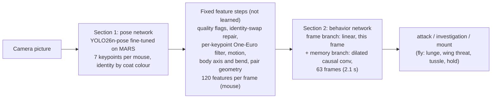
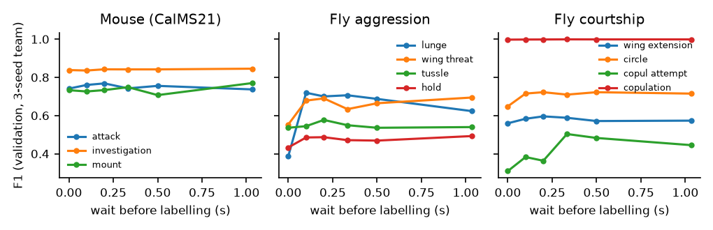

# EthoLive

**Causal, real-time behavior classification from animal pose, and a measurement of what being live costs.**

Ava Sajjadi, University of Massachusetts Boston

Manuscript: *The Cost of Being Live: How Much Future Context Real-Time Behavior Classifiers Need, in Mice and Flies*
(under review; not yet published). The LaTeX source is in [`paper/`](paper/).

## Abstract

Closed-loop neuroscience experiments must label behavior while it happens, but behavior classifiers are usually built
and benchmarked offline with access to future frames (the CalMS21 baselines see 100 frames ahead). This repository
measures what the causal constraint costs. One temporal network, with the same 63-frame (2.1 s) window, is trained and
scored with the window moved from all-past (live) to centred, at six delays and three seeds each, for 11 behaviors in
three datasets (mouse social behavior, fly aggression, fly courtship). Being live costs mice about 0.01 class-averaged
F1, about the seed spread, but costs some fly behaviors a great deal: fly lunge rises from 0.39 to 0.72 F1 with a
0.1 s wait. Across behaviors, the gain from a 0.2 s wait is larger for behaviors with shorter bouts (Spearman
rho = -0.73, n = 11), but the trend rests on the mouse versus fly contrast and is not significant among fly behaviors
alone. An exact Bayes-optimal fixed-lag decoder on simulated behaviors with controlled bout lengths gives a reference
for how much waiting can help when the only difficulty is per-frame noise; fly lunges gain more than three times that
reference. The live classifier itself, EthoLive, runs end to end on a laptop faster than a 30 fps camera and scores
0.847 class-averaged F1 on the CalMS21 Task 1 test set with no future frames.

## The question

A behavior classifier that labels frame `t` may use frames up to `t + K`. Offline tools choose `K` freely; a closed-loop
experiment that triggers a stimulus needs `K = 0` or a small wait. The research questions are:

1. For a fixed model and a fixed amount of context, how much accuracy is lost when all of the context must be in the past?
2. How short a wait recovers most of that loss?
3. Which behaviors pay the most, and is bout length the explanation?

Formally, with pose features `x_1..x_T` and per-frame labels `y_t`, a delay-`K` classifier outputs
`p(y_t | x_{t-62+K} .. x_{t+K})` from a window of fixed length 63. `K = 0` is causal; `K = 31` is a centred window
with the same length and the same number of weights. The gain of waiting is `Delta(K) = F1(K) - F1(0)`.

## Contributions

- **A controlled measurement of the cost of being live.** The network, the labels and the training recipe are fixed;
  only the position of the window moves (K in {0, 3, 6, 10, 15, 31} frames at 30 fps). 11 behaviors, two species,
  three seeds per setting, validation data only. The hypothesis and the test statistic were written into the script
  header before it ran ([`scripts/lookahead_sweep.py`](scripts/lookahead_sweep.py)).
- **A robustness analysis of the main trend** that drops behaviors and datasets and reports where the claim breaks
  (it does not hold within flies alone).
- **A Bayes-optimal reference.** Bouts with phase-type length distributions make the on/off process a hidden Markov
  chain, so the exact fixed-lag posterior can be computed and compared with the learned network
  ([`scripts/synthetic_lag.py`](scripts/synthetic_lag.py)).
- **A working causal classifier (EthoLive 0.4) with an auditable test record.** Every look at every test split is
  listed, model files are checksummed before a test run, and the scripts refuse to run a test twice.

What is not new: the pose network is Ultralytics YOLO26n-pose fine-tuned on the MARS hand-labelled pictures; the
temporal branch is a standard dilated causal 1D convolution; One-Euro filtering, class-weighted cross-entropy and seed
ensembling are established techniques. The fixed feature steps adapt methods from the author's earlier surgical
instrument tracker (ScopeScore, manuscript submitted) to animals.

## Model



- **Frame branch:** a linear layer on the current frame's features, initialised from a fitted logistic regression
  (for mice, the team's earlier Model B), so that before training Section 2 equals that classifier.
- **Memory branch:** dilated 1D convolutions (kernel 3, dilations 1, 2, 4, 8, 16, width 64, dropout 0.1, residual
  blocks with layer norm), receptive field 63 frames, all past. Its output layer starts at zero.
- **Logits** = frame branch + memory branch. Three seeds are averaged in probability (`Team`).
- **Training:** AdamW (lr 1e-3, weight decay 1e-4), batches of 32 windows of 256 frames, 300 steps per epoch, up to
  40 epochs with early stopping after 6 epochs without improvement, class-weighted cross-entropy ("balanced" weights
  for mice; square-root weights and a partial-label loss for flies, because Boy-meets-boy does not label tussle or hold);
  each network keeps the epoch with the best validation class-averaged F1.
- **Causality:** the memory branch is left-padded; a test scrambles every input after frame `t` and checks that the
  output at `t` does not change (`tests/test_etholive.py::test_section_2_never_looks_at_future_frames`). The streaming
  scorer recomputes features over a 6 s trailing buffer and matches whole-session scoring.
- **Delay K:** labels are shifted by K frames during training and the score of frame `t` is read at `t + K`
  (`info["lookahead_frames"]` in the model file).

Code: [`etholive/model.py`](etholive/model.py) (pose network wrapper, behavior network, model file),
[`etholive/scope_model.py`](etholive/scope_model.py) (temporal head, training loop, streaming scorer),
[`etholive/features.py`](etholive/features.py), [`etholive/scopescore_mouse.py`](etholive/scopescore_mouse.py),
[`etholive/scopescore_fly.py`](etholive/scopescore_fly.py) (feature steps). Full development record:
[`docs/model_card.md`](docs/model_card.md).

## Data

| Dataset | Use | Split | License |
|---|---|---|---|
| CalMS21 Task 1 (Sun et al., 2021) | mouse behavior: attack, investigation, mount | official test (19 sessions) held out; official train split by session into 56 train and 14 validation ([`splits/split_manifest.json`](splits/split_manifest.json)) | CC BY 4.0 |
| MARS hand-labelled pictures (Segalin et al., 2021) | training the mouse pose network | as published | CC BY-NC 4.0 |
| Fly vs. Fly (Eyjolfsdottir et al., 2014): Aggression, Boy-meets-boy, Courtship | fly behavior | by movie ([`splits/flyvsfly_v2_split.json`](splits/flyvsfly_v2_split.json)) | CC0 |

No dataset is redistributed here. Download instructions: [`docs/reproducibility.md`](docs/reproducibility.md).

## Results

All lookahead numbers are validation numbers (three-seed team, mean over folds for flies). No test split was used for
them. Source data: [`results/paper/lookahead/summary.csv`](results/paper/lookahead/summary.csv).

| Data | Behavior | Median bout (s) | K=0 (live) | K=3 | K=6 | K=10 | K=15 | K=31 (centred) |
|---|---|---|---|---|---|---|---|---|
| Mouse | attack | 1.45 | .741 | .760 | .768 | .742 | .755 | .737 |
| | investigation | 1.10 | .838 | .836 | .842 | .842 | .842 | .845 |
| | mount | 2.07 | .733 | .726 | .733 | .748 | .707 | .770 |
| Fly aggression | lunge | 0.13 | .388 | .719 | .700 | .706 | .687 | .623 |
| | wing threat | 0.63 | .553 | .678 | .690 | .634 | .664 | .694 |
| | tussle | 0.23 | .536 | .544 | .577 | .549 | .536 | .539 |
| | hold | 0.17 | .433 | .485 | .486 | .471 | .469 | .492 |
| Fly courtship | wing extension | 0.40 | .559 | .583 | .596 | .588 | .571 | .573 |
| | circling | 0.43 | .648 | .715 | .722 | .710 | .722 | .715 |
| | attempted copulation | 0.27 | .309 | .383 | .363 | .503 | .482 | .445 |
| | copulation | 1042 | .998 | .998 | .998 | .999 | .999 | .999 |

- Mouse class-averaged F1: 0.771 live, 0.781 at K=6, 0.784 centred. The difference is about the seed spread.
- Across the 11 behaviors, the gain at K=6 correlates with median bout length: Spearman rho = -0.73, two-sided
  permutation p = 0.014 (exact, all 11! orderings; [`results/paper/lookahead/stats_exact.json`](results/paper/lookahead/stats_exact.json)).
  For the centred window: rho = -0.55, p = 0.088.
- Removing the mouse behaviors leaves rho = -0.33 (p = 0.43): bout length and species are confounded in these data.



**CalMS21 Task 1 test** (19 sessions, run once per model; second look at this split overall). Class-averaged F1 is the
mean frame-level F1 of attack, investigation and mount. Our rows use no future frames; the published baselines use 100
past and 100 future frames, so the comparison is not controlled. Source: [`results/test_run_etholive/test_results.json`](results/test_run_etholive/test_results.json).

| Model | Future frames | Class-averaged F1 (95% session bootstrap) | Attack | Investigation | Mount |
|---|---|---|---|---|---|
| Frame-only logistic regression (Model B) | 0 | .755 (.666 to .779) | .592 | .782 | .890 |
| MouseScope 0.1 (earlier version) | 0 | .818 (.772 to .837) | .730 | .823 | .901 |
| **EthoLive 0.4** | **0** | **.847 (.811 to .868)** | .778 | .848 | .915 |

Published reference points for the same split (Sun et al., 2021): 1D-conv baseline .793, with task programming .829,
MABe 2021 Task 1 winner .864.

**Speed.** End to end from decoded picture to behavior probabilities, on an Apple M5 laptop (PyTorch MPS), 600 frames
of a CalMS21 video: 81 to 99 frames per second when the streaming scorer works in chunks of 15 frames, 61 to 63 with
chunks of 5; pose network median 6 to 9 ms per picture ([`results/benchmarks/`](results/benchmarks/),
[`scripts/bench_end_to_end.py`](scripts/bench_end_to_end.py)). Throughput is not latency: a frame's score is emitted
when its chunk is complete, up to 15 frames (0.5 s) later with chunks of 15.

**Test-set ledger.** Every look at a test split, including those by earlier models, is listed in the manuscript
(Table 4) and in [`docs/model_card.md`](docs/model_card.md). The fly test sets were used three times and are treated
as spent; no current fly model has a clean test number.

## Installation

Python 3.10 or newer. CPU is enough for the tests and the smoke checks; training and video inference use a GPU when
available (CUDA or Apple MPS).

```bash
git clone https://github.com/AvaSajjadi/EthoLive.git
cd EthoLive
python -m venv .venv && source .venv/bin/activate
pip install -e ".[video,figures,dev]"
pytest -q
```

Model files are not stored in git. Download them into `models/` and check them against
[`models/CHECKSUMS.sha256`](models/CHECKSUMS.sha256) as described in [`models/README.md`](models/README.md).

## Reproduction

[`docs/reproducibility.md`](docs/reproducibility.md) lists every entry point: dataset preparation, training, the
lookahead sweep, the simulation, figures, the validation check of the shipped file and the speed benchmark, with the
outputs each one writes and what has been re-run. The short version:

```bash
python scripts/verify_mouse_validation.py      # shipped mouse.pt on the 14 validation sessions: expect macro F1 0.771
python scripts/synthetic_lag.py                # Bayes-optimal reference (minutes, CPU)
python scripts/lookahead_sweep.py --data mouse # one arm of the measurement (GPU recommended); then --report
python scripts/paper_figures.py                # figures from results/ (byte-identical to paper/figures/)
python scripts/bench_end_to_end.py             # throughput on your computer
```

## Limitations

- 11 behaviors from three datasets; the duration trend is driven by the mouse versus fly contrast.
- All lookahead numbers are validation numbers. Fly features come from our own pose network; mouse features use the
  dataset's keypoints.
- The fly model did not transfer to a second camera without training data from it, and the fly test sets are spent.
- The CalMS21 comparison with published models is not controlled (different future context, single runs for our rows).
- Mouse data come from one laboratory's setup. The pose network inherits the MARS non-commercial license.
- The quality step that fills short keypoint gaps uses the frame after a gap (it is not causal). On CalMS21 keypoints
  it fills nothing (0 of 1.32 M validation rows); on the fly pose network's output it fills 0 to 0.003% of rows.

## Relationship to LiveTracker

[LiveTracker](https://github.com/AvaSajjadi/LiveTracker) is the laboratory software built by a team (Ava Sajjadi,
Igor Ten, Syed Taswar Mahbub) that runs EthoLive on a camera or a recording and adds researcher-approved rules, alerts
and reports. EthoLive is independent of it: this repository contains the model, its training and evaluation, and the
research. LiveTracker installs this package and loads its model files.

The model was developed from October to November 2026 inside the LiveTracker project and moved to this repository on
2026-11-26 with its recorded results; the dated development record is [`docs/model_card.md`](docs/model_card.md).

## Acknowledgements

The frame branch of the mouse model starts from Model B, the logistic regression the LiveTracker team built for the
hackathon (CalMS21 loader, split and baseline classifier by Igor Ten). Datasets: CalMS21, MARS, Fly vs. Fly.
Pose network: Ultralytics YOLO26 (AGPL-3.0).

## Citation

See [`CITATION.cff`](CITATION.cff). The manuscript is under review; cite the repository until it is published.

## License

No license has been granted yet. Until one is added, all rights are reserved by the author. Third-party components keep
their own licenses (Ultralytics YOLO: AGPL-3.0; MARS data and models: CC BY-NC 4.0; CalMS21: CC BY 4.0).
